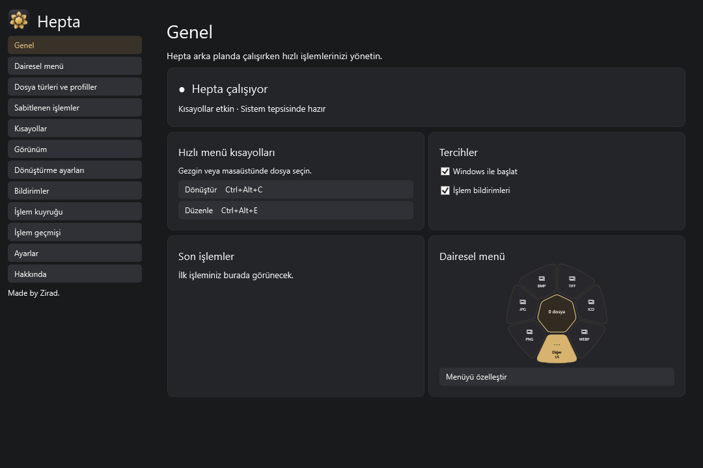

# Hepta

Windows 11 x64 için yerel dosya dönüştürme ve düzenleme uygulaması. Hepta, Windows Gezgini’ndeki seçiminiz için imlecin yanında yedi yapraklı bir menü açar. Türkçe ve İngilizce arayüz içerir.

## Kurulum ve ilk işlem

1. Kurulum dosyası yayımlandığında GitHub Releases bölümünden `Hepta-Setup.exe` dosyasını indirin ve çift tıklayın. Yerel derlemelerde dosya `release/` klasöründedir. Sağlama toplamı yanındaki `.sha256` dosyasındadır.
2. Dili, hedef klasörü ve masaüstü kısayolunu seçip **Kur** düğmesine basın. Kurucu çevrimdışı MSI paketini içerir. Hepta imzasızdır. Windows bir güvenlik uyarısı gösterirse dağıtıcının kimliğini ve dosyanın SHA256 değerini kontrol edin.
3. İlk açılışta dili, Windows ile başlatmayı ve bildirimleri seçin.
4. Gezgin’de veya masaüstünde dosya seçin. **Ctrl+Alt+C** ile menüyü açın ve hedef biçime tıklayın. Başka bir uygulamada seçim algılanamazsa **Genel → Dönüştür** üzerinden dosya seçebilirsiniz.
5. Çıktı kaynak dosyanın yanına yazılır. İsim çakıştığında yeni dosya numaralandırılır. Çok sayfalı belge çıktıları ayrı klasörde tutulur.

## Dairesel menü

**Ctrl+Alt+E** düzenleme işlemlerini açar. ZIP, TAR ve 7Z oluşturma, arşiv çıkarma, ad/yol kopyalama, ses, video, TXT ve PDF birleştirme bu menüdedir. Birden çok dosya seçildiğinde uyumsuz yapraklar soluk görünür. Alt yapraktan veya fare tekerleğiyle sayfa değiştirin. ESC veya dışarı tıklama menüyü kapatır. İşlem açıklamasını görmek için yaprağın üzerinde bekleyin. Sağ tık tek işe ait seçenekleri açar.

PDF bölmek için bölümlerin biteceği sayfaları virgülle girin. Örneğin 47 sayfada `14,37` üç dosya üretir. **PDF bölme ve birleştirme sayfa nesnelerini kopyalar.** Seçilebilir metin ve vektör çizimleri sayfada kalır. Belge düzeyindeki imza, yer imi ve etkileşimli form davranışı için çıktı ayrıca kontrol edilmelidir. Kaynak belgeler korunur. Birleştirmede tutamacı sürükleyerek dosyaları sıralayın. Dosya adına tıklayarak varsayılan uygulamada inceleyebilirsiniz.

## Tercihler ve işlem takibi

- **Dairesel menü, Görünüm ve Profiller** menü boyutu, renk, saydamlık, animasyon ve tema ayarlarını içerir. Uzantı ve işlem türünü seçip işlem sırasını sürükleyerek değiştirin. Yıldız ile sabitleyin, görünürlük düğmesiyle gizleyin.
- **Dönüştürme ayarları** kalite, medya kodlama tercihleri ve eşzamanlı iş sayısını belirler. Her Windows codec’i her seçenek birleşimini desteklemez.
- **Kuyruk** bekleyen ve çalışan işleri gösterir. İptal ya da çıktı klasörünü açma düğmesini kullanın. Birleştirme girdilerinin bir kısmı ön kontrolden geçmezse kuyrukta başarılı ve başarısız girdileri inceleyip kısmi çıktıyı saklayabilir veya silebilirsiniz.
- **Geçmiş** yereldir. Dosya adı, işlem, tarih ve durumla filtrelenebilir. Geçmişi temizleme yalnızca kayıtları kaldırır.
- **Ayarlar** dili, otomatik başlangıcı ve JSON içe/dışa aktarmayı yönetir. Pencerenin X düğmesi uygulamayı tepsiye indirir. Tamamen kapatmak için tepsiden **Çıkış** seçin.
- **Güncelleme ve kaldırma** öncesinde işleri tamamlayın ve tepsiden çıkın. Yeni kurucuyu çalıştırın veya Windows Ayarlar → Uygulamalar → Yüklü uygulamalar → Hepta → Kaldır yolunu kullanın. Kullanıcı verileri ve dönüştürülmüş dosyalar uygulama bileşenlerinden ayrı tutulur.

## Sorun giderme

Kısayol kaydedilemiyorsa Kısayollar sayfasından başka bir birleşim seçin. Windows global kayıt çakışmalarını bildirir. Her uygulamanın kendi iç kısayollarını önceden saptamak mümkün değildir. Şifreli, kilitli veya desteklenen alt kümenin dışındaki dosyalarda hata ayrıntısı kuyrukta görünür. Kurulum Windows Installer hizmetine erişim gerektirir. Bu sürümde temiz bir Windows sistemindeki kurulum, güncelleme ve kaldırma henüz doğrulanmadı.

Dosya işlemleri için hesap, sunucu veya ücretli hizmet gerekmez. Yalnızca Hakkında sayfasındaki destek bağlantısına tıkladığınızda tarayıcı açılır. Geliştirici Zirad. Kaynak kod lisansı ve destek adreslerinin yayın onayı Zirad’a aittir.

[Biçimler](SUPPORTED_FORMATS.md) · [Test raporu](TEST_REPORT.md) · [Derleme](docs/BUILD.md) · [GitHub yayın kılavuzu](docs/GITHUB_RELEASE_GUIDE_TR.md) · [English](README_EN.md)
