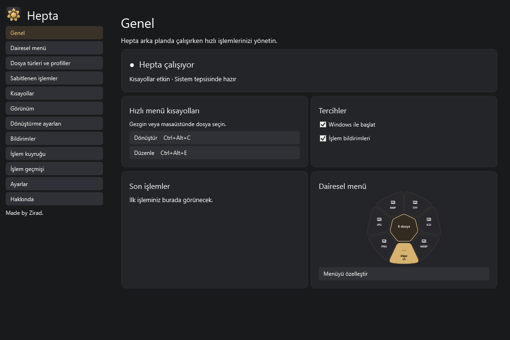

# Hepta

Hepta is a local file converter and editor for 64-bit Windows 11. Its seven-petal menu acts on files selected in Explorer or on the desktop. Turkish and English are available.

## Getting started

1. Once published, download `Hepta-Setup.exe` from GitHub Releases and double-click it. Local builds place the installer in `release/`. Verify the SHA256 file and publisher provenance before running an unsigned download.
2. Pick the language, installation folder and desktop shortcut option. The setup contains its Windows Installer payload and works without downloading dependencies.
3. On first launch, choose your language, startup preference and notifications.
4. Select a file in Explorer. Press **Ctrl+Alt+C**, then click an output format. You can also choose files from Overview.
5. Find the output next to its source. Existing names get numbered suffixes. Multiple page images go into a separate folder.

**Ctrl+Alt+E** opens editing tools. Select multiple items to create an archive, join files or copy their names or paths. Use the bottom petal or mouse wheel to change pages. Escape or clicking outside closes the menu. Hover for compatibility information and right-click for one-time settings.

## Documents and jobs

For PDF splitting, enter the last page of each section. On a 47-page document, `14,37` creates three files. **PDF splitting and joining copy page objects with their text and vector content.** Check document-level signatures, outlines and form behaviour separately. Originals are kept. Drag the handle to order merge inputs and click a name to open it in the default viewer. Independent conversions save each output beside its own input. Merges default to the first input directory.

Profiles support reordering, pinning and hiding actions by extension and menu. Appearance includes light, dark and system themes. Conversion defaults control encoding settings and concurrency. Queue shows live jobs, cancellation, output folders and pending partial results. After a merge preflight excludes inputs, review the included files and errors, then keep or discard the staged output. History can be searched, filtered, disabled and cleared independently of output files.

Settings can be imported and exported as JSON. Closing the main window hides it in the tray. Select **Exit** in the tray after jobs finish to quit. Exit before updating or uninstalling. Uninstall through Windows Settings → Apps → Installed apps. Application preferences and user outputs are stored separately from the installed program.

If a shortcut conflicts, choose another combination. Per-application accelerators cannot all be detected in advance. Unsupported codecs, encrypted files and invalid inputs are reported in the queue. Setup requires access to the Windows Installer service. A clean-machine installation, upgrade and uninstall remain to be verified.

Hepta processes files locally. Support links open the browser only when clicked. Source licensing and support addresses are subject to owner review before publication.

[Format matrix](SUPPORTED_FORMATS.md) · [Test report](TEST_REPORT.md) · [Build instructions](docs/BUILD.md) · [Türkçe](README.md)
